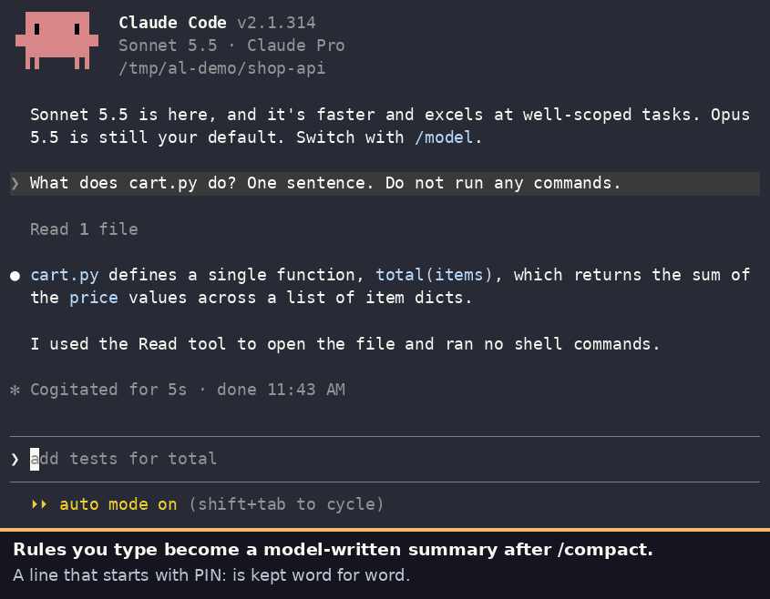

# agent-ledger

[](https://github.com/rzaaeeff/agent-ledger/releases/latest) [](https://github.com/rzaaeeff/agent-ledger/actions/workflows/on-merge.yml) [](LICENSE)

When Claude Code compacts a conversation, your earlier instructions survive only as well as the model-written summary keeps them. In a short session that is often word for word. Over a long one, a rule can come back reworded or not at all ([#94564](https://github.com/anthropics/claude-code/issues/94564), [#104779](https://github.com/anthropics/claude-code/issues/104779)).

agent-ledger keeps the lines you mark with `PIN:` outside the conversation and puts them back after every compaction, byte for byte, whatever the summary did. It is a small local hook for Claude Code and Codex: no model calls, no server, no database.



```
PIN: don't touch the migrations, the schema is frozen until Friday
```

After `/compact`, the agent sees that pin again, word for word, and you get a one-line note saying what was restored.

**Status: v0.1, early.** Tested live on Claude Code 2.1.314 (Linux) and 2.1.284 (Windows, Git Bash), and Codex 0.164 and 0.166 (Linux); CI runs the tests on Linux, macOS and Windows. That is one person's runs, not wide use: please report what breaks.

## Is it for you?

Use it if your sessions are long enough to compact and you keep repeating the same instructions after they do.

Skip it if:

- The rule should hold forever. Put it in `AGENTS.md` or `CLAUDE.md`; the agent already rereads those. (`PROMOTE:` moves a pin there when it turns out to be permanent.)
- You want searchable memory across projects or automatic notes. This only keeps what you mark, plus recent prompts.

What it does not do: make the model obey. It keeps your text in the context; whether the agent follows it is still up to the model.

## Install

Claude Code:

```
/plugin marketplace add rzaaeeff/agent-ledger
/plugin install agent-ledger@agent-ledger
```

Codex (macOS and Linux; experimental):

```
codex plugin marketplace add rzaaeeff/agent-ledger
codex plugin add agent-ledger@agent-ledger
```

then start Codex and, at "Hooks need review", trust the agent-ledger hooks. Each update asks again.

On first use the plugin downloads one binary (about 3 MB) from the GitHub release; your first prompt waits a few seconds for it. It works only inside a git repository. Requirements, checksums and failure handling are under [How the install works](#how-the-install-works).

## Using it

Start a prompt with one of these. Forgot them? Send `LEDGER?` for a cheat sheet.

| Prefix | Who sees it | After `/clear` |
|---|---|---|
| `PIN:` | this chat | dropped; you get a list of what was dropped (kept if `key` is `branch` or `repo`) |
| `PIN!:` | this chat | kept |
| `CARRY:` | the next chat after `/clear`, once | handed over, then deleted |
| `PIN@branch:` | every chat on this branch (refused on `main`, `master`, the default branch and a detached HEAD) | kept |
| `PIN@repo:` | every chat in this repo | kept |
| `PIN@global:` | every chat in every repo | kept |
| `PINS?` | lists your pins with numbers; only you see it, the agent gets nothing | |
| `LEDGER?` | the cheat sheet and what's stored; only you see it | |
| `PIN [ref]: <new text>` | rewords a pin; it keeps its scope and lifetime | |
| `UNPIN: <ref>` | removes a pin | |
| `PROMOTE: <ref>` | moves a pin into `CLAUDE.md` or `AGENTS.md` (see `promote_to`), uncommitted | |

`PIN!:` and `CARRY:` are easy to mix up. A pin is a rule, so it is put back after every compaction until you `UNPIN` it. `CARRY:` is a note about where you left off, delivered once into the next chat and then deleted, which is why `PINS?` never lists it. Pinning "the auth refactor is half done" would still be telling the model that next week, long after it stopped being true.

```
CARRY: login.py is migrated, signup.py is not. I changed the session table by hand, leave it.
```

In Claude Code each one is also a slash command: `/pin <text>`, `/pin ! <text>`, `/pin @repo <text>`, `/pins`, `/unpin <ref>`, `/carry <text>`, `/promote <ref>` and `/agent-ledger:help` (type `/agent-ledger:` to see them all; if another skill is already called `/pin`, use `/agent-ledger:pin`). `/pin` alone lists your pins. In Codex the same names work as `$pin`, `$pins`, `$agent-ledger:help` and so on. A slash or `$` command never reaches the model and takes one line; to pin and ask in one message, use the prefix.

A `<ref>` is a number from `PINS?`, a pin's id, `last`, or words from the pin. Prefixes work in any case (`pin:` = `PIN:`) but only at the start of the prompt; "pin:" in the middle of a sentence is ignored. A command is the first line only: the rest of the prompt goes to the agent as usual. Near misses like `PIN; x` or `PIN x` save nothing and tell you so (the prompt still goes to the agent). A lower-case `pin:` saves and offers `UNPIN: last` in case you didn't mean it.

Claude Code prefixes every reply to a command with `UserPromptSubmit operation blocked by hook:`. That label is Claude Code's and the plugin cannot change it. It means the command was handled locally and never reached the model. The text after it (`pinned [a1b2]. (2 pins apply here)`) is the reply. Nothing was rejected.

You don't have to remember a pin's exact wording:

- `UNPIN: friday migrations` finds "Don't touch the migrations until Friday": case, punctuation and word order don't matter, and a word of 4+ letters also matches longer words starting with it (`migration` finds "migrations"). Words match whole, so `all` does not find "called"; refs under 3 letters only match ids. `UNPIN: last` takes the newest pin, `UNPIN: 2` the second one in `PINS?`.
- If nothing or more than one pin matches, nothing is removed and you get the closest pins with their ids.
- Pinning the same text again does nothing (`PIN!:` on a `PIN:` makes it survive `/clear`); if only case or punctuation differ, you're shown the stored wording so you can reword it. Pinning something close to an existing pin saves it and names the old one, so you can `UNPIN` it if the new one replaces it. The tool never decides that for you.

To keep a decision, pin it: `PIN: chose SQLite over Postgres, single user`.

The agent is told that pins are kept by agent-ledger and not to copy them into its memory, `CLAUDE.md` or `AGENTS.md`; a copy there would outlive `UNPIN` and `/clear`. `PROMOTE:` is the deliberate way to make a pin permanent: it adds it under `## Project rules` in that file.

To check what is stored or what the next compaction would inject:

```
agent-ledger status
agent-ledger preview          # or: preview clear
```

Run these from the agent's shell (e.g. `!agent-ledger status` in Claude Code): Claude Code puts plugin `bin/` folders on its shell's PATH, and from a normal terminal there is no session id, so you'd see the branch ledger, not your chat's. In Codex, call the plugin's `bin/agent-ledger` by full path. Both find the binary under `CLAUDE_CONFIG_DIR` or `CODEX_HOME` if you set them.

## Why not `CLAUDE.md`, or a five-line hook?

**`CLAUDE.md` / `AGENTS.md`** are the right place for rules that hold forever, and the agent already rereads them after compaction. They are the wrong place for "until Friday", "on this branch only" or "for this chat only": you have to open a file, edit it, and remember to take it out again, and in a shared repo your teammates get your temporary rule too. Pins are one line, scoped, and removable with `UNPIN: friday`. When a pin turns out to be permanent, `PROMOTE:` moves it into that file for you.

**A five-line `SessionStart` hook** that cats a file into the context does most of the restore, and the Claude Code docs show one. What the five lines don't give you: scopes (chat, branch, repo, global) and a `/clear` lifetime for each, removing a pin by words rather than exact text, a handover into the next chat, a size budget that fits under the 10k hook limit so the restore isn't truncated, secret masking before anything is written, idle ledgers pruned after 30 days, most of the same behaviour in Codex (not the `/clear` handover, which Codex gives no hook for), and commands that cost no model turn. If you only need the restore, write the five lines.

**Automatic memory tools** (claude-mem and similar) capture everything and compress it with a model. That is a different trade: broader coverage, paraphrased text, model calls. agent-ledger keeps only what you mark, and keeps it byte for byte.

## Privacy

- By default only ledger commands are logged, not your other prompts. `"logging": "all"` also logs every prompt, and then your last 5 come back after compaction.
- Before anything is stored, common secrets are masked: API keys, GitHub/Slack/AWS tokens, private keys, JWTs, Stripe keys, Slack webhook URLs, URL passwords, and `password=`-style values (also names like `db_password`, quoted or not). This is pattern matching. It will miss some secrets, and it can mask harmless text that looks like one.
- Files stay on your machine, under `~/.local/state/agent-ledger/` and readable only by you. The tool itself makes no network calls apart from downloading its own binary and checksum file from the GitHub release (retried until it succeeds); what it re-injects goes to your model provider like the rest of the chat. When a session starts, ledgers in that repo untouched for 30 days are deleted, including their `PIN!:` pins. `PIN@branch:` pins go once the branch is deleted and idle. Repo and global pins are kept until you `UNPIN` them.
- A repo's `.agent-ledger.json` can only make `logging`, `redact`, `key` and `prune_days` stricter than your own settings, and its `promote_to` may only be `AGENTS.md` or `CLAUDE.md`. Anything else is ignored; the session-start note says so and `agent-ledger config` says why.
- What comes back after compaction is framed for the agent as your notes: pins are your words; recent prompts are quoted context, not new instructions. That lowers the risk of old text being read as a fresh order; it does not remove it.

## Where it works

| Tool | Status |
|---|---|
| Claude Code: CLI, VS Code, JetBrains, desktop Code tab | Works in the CLI (tested live). The others share its hooks and plugins, but the VS Code panel does not show the one-line notes ([#80882](https://github.com/anthropics/claude-code/issues/80882)). On Windows, hooks need Git Bash |
| Codex: CLI and desktop app | Experimental, macOS/Linux. Not on Windows yet (Codex runs hooks with `cmd.exe`; the plugin ships no Windows command). Codex already keeps recent user messages word for word when it compacts, so the gain is smaller there: mostly old rules and `PIN@branch`/`@repo`/`@global` across `/new` |
| Codex IDE extension | Plugins aren't installed there; manual hook setup may work, untested |
| Claude Code on the web, Codex cloud | No. The ledger is a local folder |

Codex `/clear` opens a new thread with no link to the old one, so `PIN:`, `PIN!:` and `CARRY:` don't cross it; the new chat says so when that may have lost something. Use `PIN@branch:` or `PIN@repo:` there.

## How chats are told apart

By default each chat has its own ledger, keyed by the session id Claude Code or Codex passes to the hooks. Switching branch or worktree mid-chat keeps the same ledger, and a second chat on the same branch never sees the first one's pins.

After `/clear`, Claude Code starts a new session id. Your `PIN!:` pins and `CARRY:` items move to it only if exactly one chat in the same folder was cleared in the last 10 minutes. If several were, or the end-of-chat hook didn't run, nothing moves and you are told. A forked chat starts its own ledger (it sees branch, repo and global pins, not the original chat's).

Which repo you are in is decided by the path of its `.git` directory, so two checkouts with the same name stay apart and a subdirectory uses the same ledger as the root. That path also names the ledger folder, so moving or renaming a repo starts an empty one. Nothing warns you: you just see "No pins here". The old pins are not lost, they sit under the old folder name in `~/.local/state/agent-ledger/` (`agent-ledger status` prints the path of the ledger in use, which shows you the naming). The idle cleanup only ever looks at the repo you are in, so that folder stays until you delete it: copy anything you still want, or pin it again.

Without a hook session id (`status`, `preview`), the ledger comes from `CLAUDE_CODE_SESSION_ID`, `CLAUDE_SESSION_ID` or `CODEX_THREAD_ID`, else the current branch (`detached` on a detached HEAD). You get a warning when it falls back to the branch.

## Configuration

Optional. Put it in `~/.config/agent-ledger/config.json` (yours) or `.agent-ledger.json` in the repo (the team's). Env vars `AGENT_LEDGER_<KEY>` override both. `agent-ledger config` shows the effective values and where each came from.

```json
{ "key": "session", "logging": "pins-only", "redact": "on", "prune_days": 30 }
```

| Key | Values | Default |
|---|---|---|
| `key` | `session`, `branch`, `repo`: who shares one ledger (a repo file can't widen it) | `session` |
| `clear` | `drop`, `keep`: what `/clear` does to `PIN:` pins | `drop` for `session`, else `keep` |
| `logging` | `all`, `pins-only`, `off` | `pins-only` |
| `redact` | `on`, `off` | `on` |
| `prune_days` | days of no activity before a ledger is deleted; `0` = never | `30` |
| `recent_prompts` | how many come back after compaction (with `logging: all`) | `5` |
| `budget_bytes` | size limit of what is re-injected, in bytes, at most 9500 (Claude Code keeps 10,000 characters of hook output, Codex about 10,000 bytes). Older prompts are dropped to fit; pins that still don't fit are left out, and the agent is told so at the top | `9000` |
| `promote_to` | file name `PROMOTE:` writes to | the one of `CLAUDE.md`/`AGENTS.md` that exists; with both, `CLAUDE.md` (what Claude Code reads) unless it imports `@AGENTS.md` or you run Codex; with neither, `AGENTS.md` |

Invalid values are ignored and listed by `agent-ledger config`.

## How the install works

On first use the plugin downloads one binary (about 3 MB) for your OS from the GitHub release into the plugin's data folder (`~/.local/share/agent-ledger/` when run outside a plugin), and checks its SHA-256 against the release's checksum file (this catches a broken download, not a compromised release). Your first prompt waits up to a few seconds for the download. If it isn't done by then, you see "still installing": that prompt is not recorded, and a ledger command is blocked so you can send it again. If the download fails, you are told on each prompt, with the path of a marker file you can delete to retry at once; otherwise it retries after 5 minutes, then hourly. Needs `bash`, `curl`, `awk`, `git` and `sha256sum` or `shasum`, and only works inside a git repository (elsewhere a `PIN:` tells you so).

Your normal prompts are never blocked. Slash commands, `PIN:`, `PINS?`, `LEDGER?`, `CARRY:`, `UNPIN:`, `PROMOTE:` and rewording are answered without a model turn when the prompt is only that line (with more lines, the prompt goes to the agent as usual); the agent hears about new, removed or changed pins with your next prompt. In Claude Code the command stays in the input box after the reply; clear it (Ctrl+U) before typing on. If the download fails, the reason goes to `skips.log` in `~/.local/state/agent-ledger/` (or `$XDG_STATE_HOME/agent-ledger/`). If saving a pin fails, you see "NOT SAVED" and the error goes to `errors.log` in the ledger folder.

To update:

```
claude plugin marketplace update agent-ledger
claude plugin update agent-ledger
```

then restart Claude Code. The new binary is fetched on your next prompt, because each version keeps its own copy, so there is nothing else to run. Your pins are untouched by an update. In Codex, run `codex plugin marketplace update agent-ledger` and then the `codex plugin add` line again; it asks you to trust the hooks again.

## Cost

On a slow 2-core VM each hook takes 40-75 ms plus about 65 ms for the launcher script, so roughly 0.1 s per prompt. After compaction at most 9,000 bytes come back (about 2,000-2,500 tokens). When you pin past 6,000 bytes, the `PIN:` reply warns you.

## Uninstall

Claude Code: `/plugin uninstall agent-ledger@agent-ledger` (this also removes the downloaded binary).

Codex: `codex plugin remove agent-ledger@agent-ledger`, then `rm -rf ~/.codex/plugins/data/agent-ledger-agent-ledger` (Codex leaves the binary behind).

Your pins and logs are not removed by either. To delete them: `rm -rf ~/.local/state/agent-ledger` (or `$XDG_STATE_HOME/agent-ledger`), and `~/.config/agent-ledger` if you made a config file.

## Development

```
go test ./...
scripts/release.sh   # builds all 6 targets + checksums.txt into dist/
```

`AGENT_LEDGER_BIN=/path/to/binary` makes the plugin use your own build. `AGENT_LEDGER_DEBUG=1` logs every hook input to `hooks.debug.log` in the repo's ledger folder.

## License

MIT
